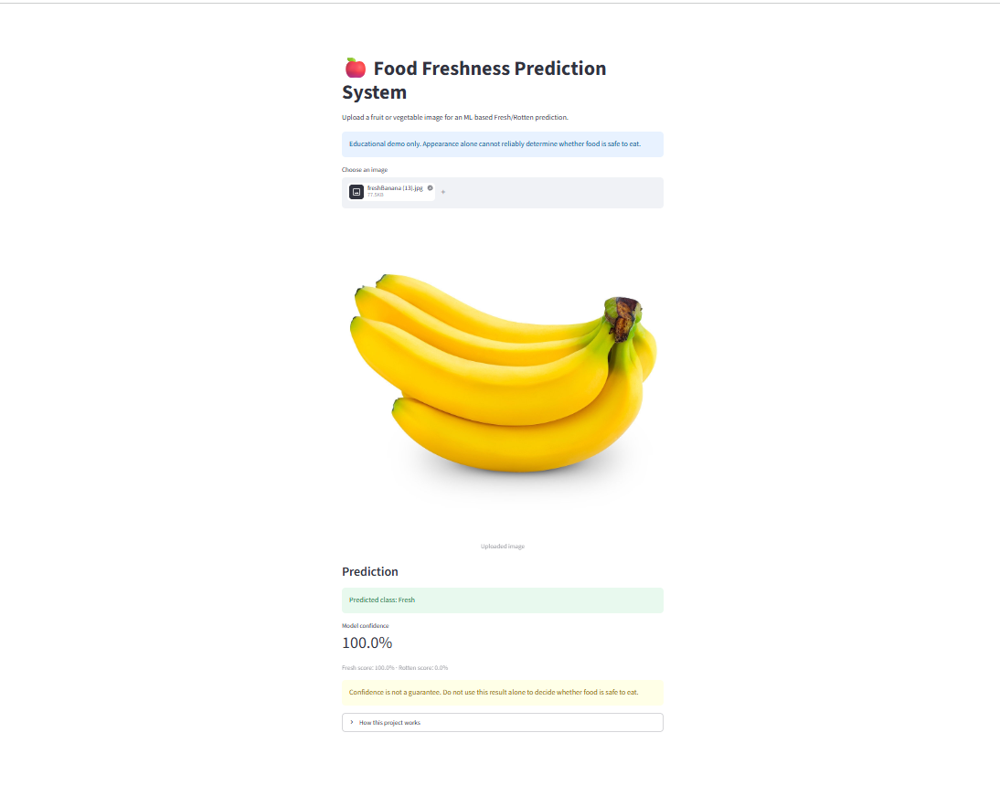
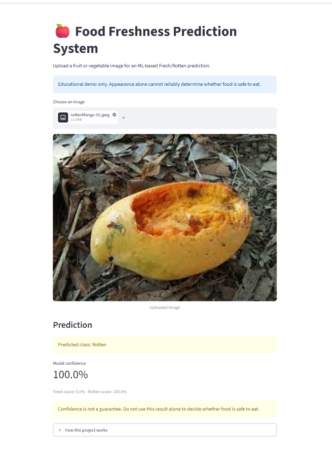

# 🍎 Food Freshness Prediction System

---

## ✨ Features

- **⚡ Instant Freshness Detection**: Automatically predicts whether uploaded fruits and vegetables are **Fresh** or **Rotten**.
- **📊 Real-time Confidence Metrics**: Displays accurate prediction confidence percentage along with class score breakdown (`Fresh score %` vs. `Rotten score %`).
- **🖥️ Interactive Web UI**: Clean and intuitive Streamlit dashboard with drag-and-drop file uploading and instant image preview.
- **🎨 Dynamic Visual Feedback**: Color-coded alert badges (Green for **Fresh**, Orange/Red for **Rotten**) to easily indicate food status.
- **🔬 Smart Color & Texture Analysis**: Uses RGB spatial pixels, 16-bin color histograms, and channel statistics (mean & standard deviation) for fast and precise inference.
- **🍏 Multi-Produce Support**: Works across multiple fruits and vegetables including Apples, Bananas, Oranges, Tomatoes, Carrots, Cucumbers, Bell Peppers, Mangoes, Potatoes, and Strawberries.

---

## 🖼️ Output Images

### 1. Fresh Food Prediction Output

---

### 2. Rotten Food Prediction Output

